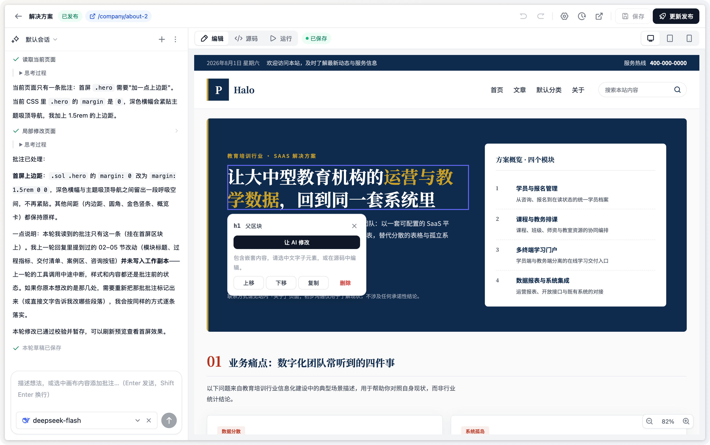
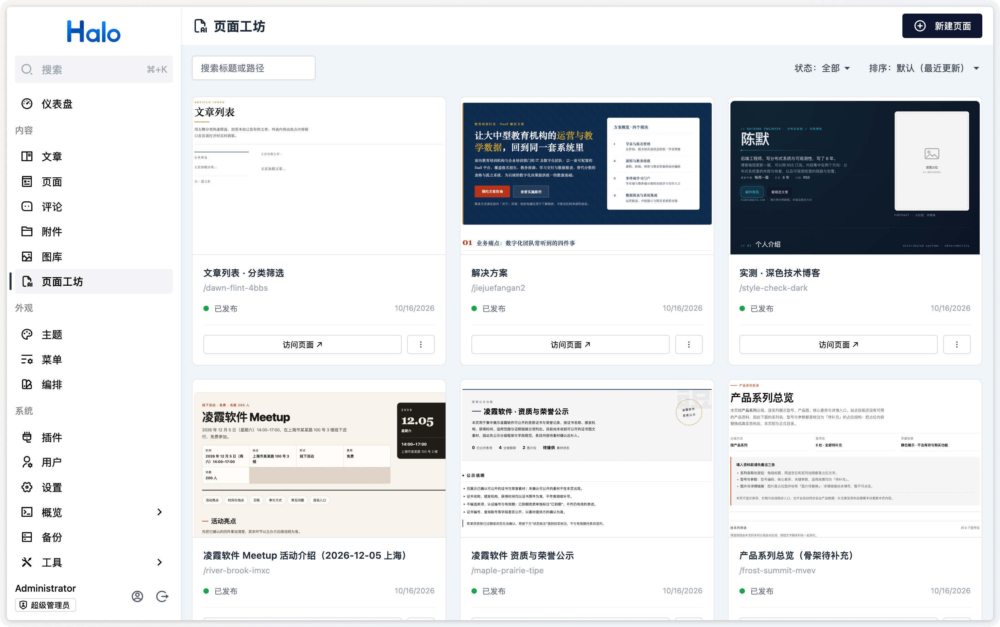
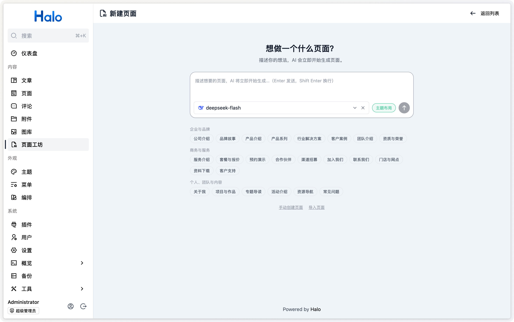
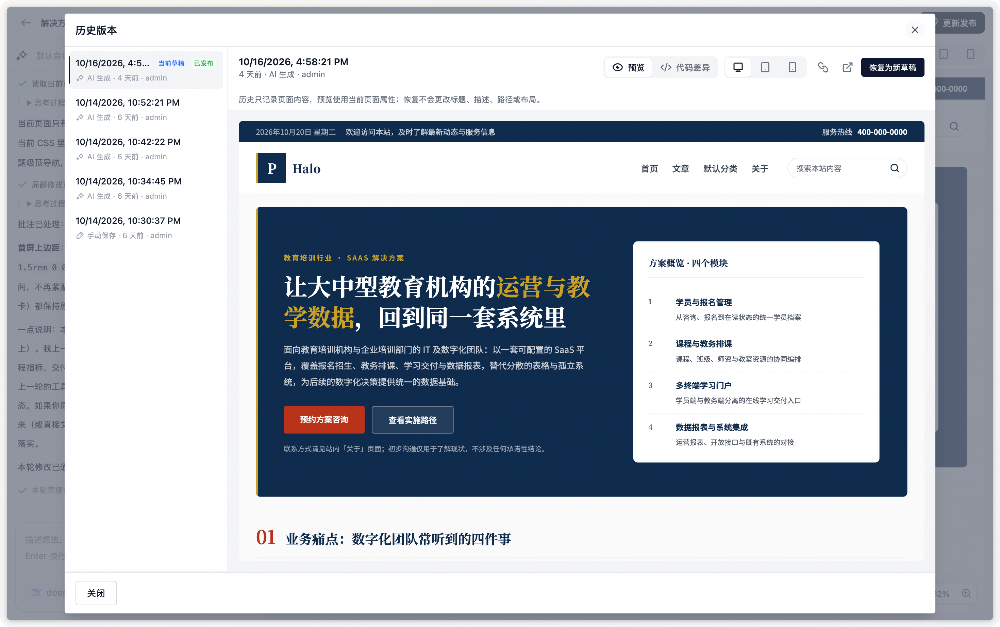

# AI 页面工坊

用自然语言为 Halo 创建页面，通过对话或可视化编辑调整内容，预览满意后即可发布。AI 会结合当前主题风格和站点内容，帮助你制作活动页、品牌介绍页、内容专题页等静态页面。

## 功能特性

- **AI 创建与修改**：描述需求生成页面，再通过对话或画布批注持续调整。
- **可视化与源码编辑**：点选元素修改文字、链接、图片，也可直接编辑 HTML、CSS 和 JavaScript。
- **主题融合与多端预览**：可复用主题的页头页尾和基础样式，预览桌面、平板、手机及亮暗模式下的效果。
- **历史与复用**：查看和恢复历史版本，克隆页面，或通过 ZIP 导入导出。
- **外部 Agent 接入**：通过 MCP 让 Codex、Claude Code 等客户端创建、修改和发布页面。

## 适用场景

- **活动与产品落地页**：为活动推广、产品发布或服务介绍快速制作页面。
- **品牌与介绍页**：展示公司介绍、品牌故事、团队成员等内容。
- **行业解决方案页**：结合站点已有的产品介绍、客户案例和行业文章，整理面向目标客户的解决方案。

## 功能预览

## 安装与使用

### 使用要求

- Halo 2.26.0 或更高版本，当前仅支持单实例部署，且仅超级管理员可用。
- AI 生成和导入安全审查需要安装并启用 [AI Foundation](https://www.halo.run/store/apps/app-acslk9nu) 1.1.1 或更高版本，并配置支持工具调用的语言模型。

### 安装

1. 从 [应用市场](https://www.halo.run/store/apps/app-gscuxwkq) 安装，或从 [GitHub Releases](https://github.com/halo-dev/plugin-ai-page-builder/releases) 下载 JAR 文件，在 Halo Console 的「插件」中安装并启用。详见 [Halo 插件安装文档](https://docs.halo.run/user-guide/plugins)。
2. 如需使用 AI，在 [AI Foundation](https://www.halo.run/store/apps/app-acslk9nu) 中配置 Provider、模型和默认语言模型。
3. 从「内容 → 页面工坊」进入。

### 开始使用

1. **创建页面**：描述需求并选择模型，让 AI 生成页面；也可以手动创建空白页面，或导入已导出的 ZIP 文件。
2. **编辑与预览**：通过对话、可视化画布或源码调整内容，切换设备尺寸检查布局。需要检查脚本交互时，保存草稿后切换到「运行」视图。
3. **发布页面**：保存草稿，点击「发布」并设置访问路径。后续修改通过「更新发布」上线，也可以随时取消发布。

例如，可以向 AI 描述：

> 为我们的企业官网创建一个「网站建设服务」落地页，包含服务优势、交付流程、客户案例和咨询入口，沿用当前主题风格。

发布后的脚本会在站点环境执行，请只发布已经检查并信任的页面内容。编辑、历史版本和导入导出的详细说明见 [使用指南](./docs/usage.md)。

## 外部 Agent 接入

安装并启用 **[MCP Server](https://www.halo.run/store/apps/app-ybv96zol) 1.3.0 或更高版本**后，可让 Codex、Claude Code 等客户端通过 MCP 管理页面。在「工具 → MCP 服务」创建访问密钥并选择 AI 页面工坊的工具，连接方式见 [接入指南](./docs/mcp.md)。

例如：

> 为我们的企业官网创建一个新品发布页，展示产品亮点、应用场景和预约演示入口，复用主题布局。完成后给我预览链接，先不要发布。

## 开发

本地运行、测试和构建方式见 [开发指南](./docs/development.md)。

## 许可证

[GPL-3.0](./LICENSE) © Halo
